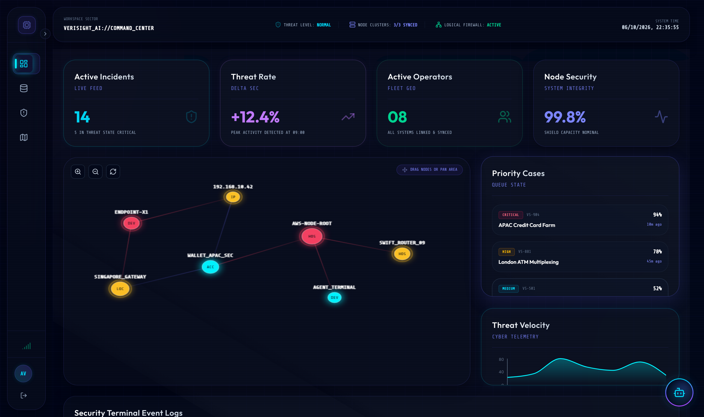
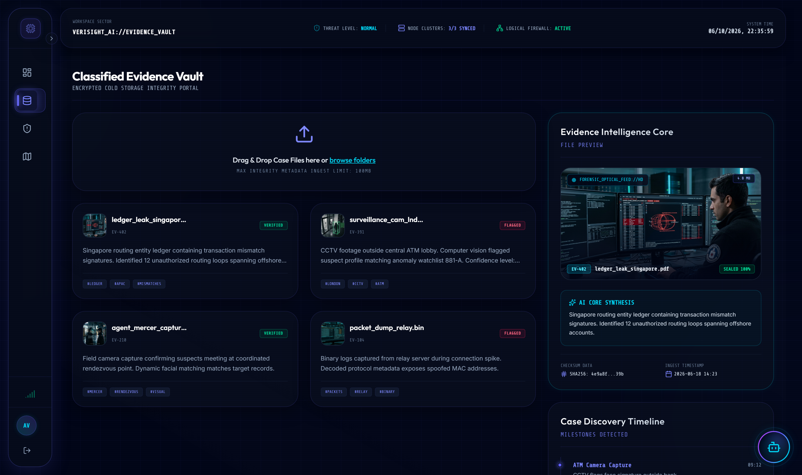
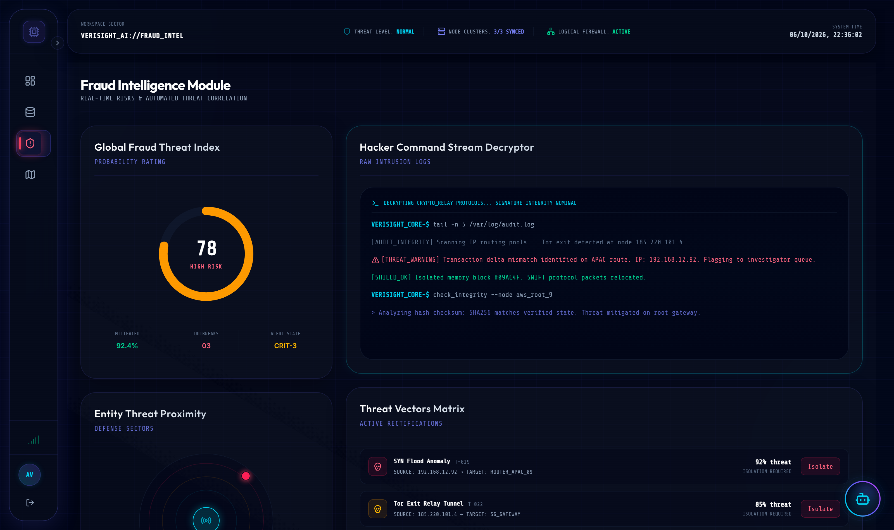
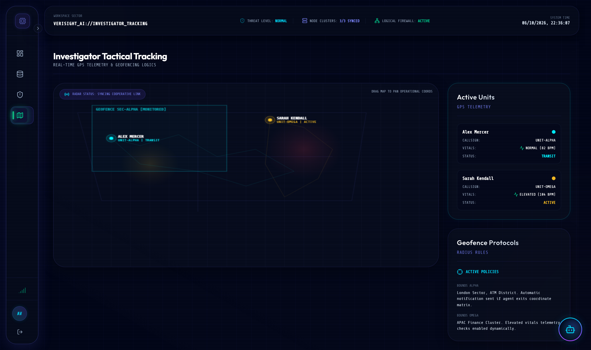

<div align="center">

# ⚡ VeriSight NX
### Next-Generation Autonomous Fraud Intelligence & Tactical Investigation Operating System

[](https://nextjs.org/)
[](https://react.dev/)
[](https://tailwindcss.com/)
[](https://www.typescriptlang.org/)
[](https://threejs.org/)
[](https://github.com/paras999000/VeriSightNX)

<p align="center">
  <b>VeriSight NX</b> is an enterprise cyber-forensics and fraud ring detection cockpit designed for intelligence agencies, Tier-1 financial institutions, and cyber response task forces. Built with biometric security, real-time telemetry, cryptographic evidence preservation, and neural threat analysis.
</p>

---

</div>

## 🌐 System Visuals & Core Modules

VeriSight NX features an ultra-responsive cyberpunk glassmorphism HUD built with GPU-accelerated motion, real-time node graphing, and neural forensics.

### 1. 🛡️ Autonomous AI Command Center
Interactive graph database visualizing compromised servers, SWIFT routers, routing hops, and financial endpoints with real-time velocity metrics and queue triage.



---

### 2. 🗄️ Classified Evidence Vault
Encrypted cold-storage repository with SHA-256 cryptographic verification, optical forensic feed inspection, dynamic metadata parsing, and audit discovery timeline.



---

### 3. ⚡ Fraud Intelligence & Hacker Stream Decryptor
Real-time probability scoring engine, live intrusion log decrypter, proximity defense radar, and rapid threat mitigation matrix for immediate IP & subnet isolation.



---

### 4. 🛰️ Investigator Tactical Geospatial Radar
Field operative GPS telemetry tracking, live biometric vitals feed, multi-point geofence containment, and tactical mission deployment coordination.



---

## 🚀 Key Features

- **Biometric & Token Authentication:** Multi-factor clearance barrier featuring 3D interactive particle matrix and simulated biometric scanner.
- **Dynamic Node Link Graphing:** Interactive HTML5 Canvas graph rendering interconnected entities, rogue gateways, and flagged transactions with live physics and drag-and-drop manipulation.
- **Forensic Chain-of-Custody Vault:** Tamper-evident evidence storage with SHA-256 checksums, drag-and-drop ingest, and AI-powered intelligence summarization.
- **Real-Time Threat Decryption Stream:** Live streaming security terminal with automated intrusion signature analysis and anomaly tagging.
- **Tactical Field Coordination:** Geofence radar boundaries with real-time agent status telemetry and telemetry anomaly alerts.
- **Autonomous AI Copilot:** Floating neural assistant offering real-time investigative summaries, threat level assessments, and voice/chat interaction.
- **Dual Visual Themes:** Ultra-deep Cyber Dark HUD and High-Contrast Light Mode with seamless state persistence.

---

## 🛠️ Technology Stack

| Domain | Technology | Description |
| :--- | :--- | :--- |
| **Framework** | [Next.js 16.2.9](https://nextjs.org/) | App Router, Server Components & Turbopack |
| **UI Library** | [React 19.2.4](https://react.dev/) | Concurrent rendering, latest hooks & actions |
| **Styling** | [Tailwind CSS v4](https://tailwindcss.com/) | Next-gen CSS engine with custom `@theme` tokens |
| **Animations** | [Framer Motion 12](https://motion.dev/) | Smooth layout transitions & gesture tracking |
| **3D Graphics** | [Three.js](https://threejs.org/) | Interactive WebGL particle wave canvas |
| **Charts** | [Recharts 3](https://recharts.org/) | High-performance telemetry & threat velocity analytics |
| **Iconography** | [Lucide React](https://lucide.dev/) | Crisp, unified cyber-security iconography |
| **Language** | [TypeScript 5](https://www.typescriptlang.org/) | Strict end-to-end type safety |

---

## 📂 Repository Structure

```text
VeriSightNX/
├── public/
│   ├── evidence/                # Forensic evidence assets
│   │   ├── agent_mercer_capture.jpg
│   │   ├── ledger_leak_singapore.jpg
│   │   ├── packet_dump_relay.jpg
│   │   └── surveillance_cam_lnd.jpg
├── screenshots/                 # High-resolution retina system screenshots
│   ├── 01_ai_command_center.png
│   ├── 02_classified_evidence_vault.png
│   ├── 03_fraud_intelligence.png
│   └── 04_investigator_tactical_map.png
├── src/
│   ├── app/
│   │   ├── globals.css          # Glassmorphism & cyber styling system
│   │   ├── layout.tsx           # Security headers & root shell
│   │   └── page.tsx             # Auth gateway & view state router
│   └── components/
│       ├── dashboard/
│       │   ├── AICommandCenter.tsx     # Threat triage & node graph
│       │   ├── AICopilot.tsx           # Floating AI assistant
│       │   ├── DashboardLayout.tsx     # Shell, topbar & navigation
│       │   ├── EvidenceVault.tsx       # Cold-storage & file analysis
│       │   ├── FraudIntel.tsx          # Anomaly detection & stream decryptor
│       │   ├── InvestigatorMap.tsx     # Tactical radar & GPS telemetry
│       │   └── Sidebar.tsx             # Collapsible HUD dock
│       ├── login/
│       │   ├── LoginPanel.tsx          # Credentials & biometric scanner
│       │   └── ThreeLoginVisual.tsx    # Interactive 3D particle canvas
│       └── ui/
│           ├── GlassCard.tsx           # Reusable frosted glass container
│           └── ThemeToggle.tsx         # Dark/Light HUD toggle
├── next.config.ts               # Next.js optimization configuration
├── package.json                 # Dependencies & project scripts
└── tsconfig.json                # TypeScript compilation settings
```

---

## ⚡ Getting Started

### Prerequisites

- **Node.js**: `v20.x` or later
- **npm** or **pnpm**

### Installation

1. **Clone the repository:**
   ```bash
   git clone https://github.com/paras999000/VeriSightNX.git
   cd VeriSightNX
   ```

2. **Install dependencies:**
   ```bash
   npm install
   ```

3. **Start the development server:**
   ```bash
   npm run dev
   ```

4. **Open the system:**
   Navigate to [http://localhost:3000](http://localhost:3000) in your browser.
   - Click **"Inject Classified Security Tokens"** on the login gate for one-click demo credentials.
   - Click **"Authenticate Operator Clearance"** to initiate biometric verification and enter the command center.

### Production Build

```bash
npm run build
npm run start
```

---

## 🔒 Security & Cryptographic Integrity

- All evidence files are tracked with simulated **SHA-256 integrity digests**.
- Geofence alarms and packet spoof warnings simulate real-time enterprise SIEM/EDR ingest.
- Designed adhering to OWASP Application Security Standards.

---

<div align="center">
  <sub>Engineered for Mission-Critical Cyber Threat Operations. &copy; 2026 VeriSight AI Core.</sub>
</div>
